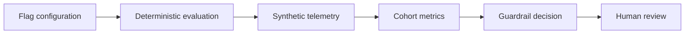

# RolloutLab

**Progressive delivery with release guardrails.** RolloutLab keeps feature-flag cohorts stable, replays health signals for each cohort, and explains whether a rollout should advance, wait for more data, or pause.

> **Status:** early development, following a 12-week roadmap (see below). It uses a sample storefront and synthetic telemetry.

## The problem

A team releases a feature to 10% of users and needs to decide whether to expand. To decide well, they need:

- users to stay in the same cohort as the rollout grows
- health metrics split by cohort, with enough data to trust
- a clear rule for when to stop, and a record of who decided what

RolloutLab provides this and keeps the final rollback decision with a person.

## Demo workflow

1. Roll out a checkout feature to 10% of 1,000 synthetic users
2. Replay telemetry where treatment errors rise to 6% against a 1% baseline
3. See why expansion to 50% is blocked, and which rule was breached
4. Review and approve a simulated rollback

The guardrail shows a correlation, not proof of cause, and the UI says so.

## Planned features

- Environments, flags, variants and targeting rules
- Stable percentage cohorts based on the flag, a salt and the subject key
- Flag evaluation through an API and an OpenFeature-compatible provider
- Sample storefront that shows evaluation reasons
- Rollout stages managed by a state machine
- Replay and deduplication of synthetic telemetry, aggregated by cohort and time window
- Guardrails with thresholds and minimum sample sizes
- Release dashboard with metric trends and decision history
- Simulated rollback proposals with role checks and an audit trail

## Tech stack

| Layer | Technology |
|---|---|
| Frontend | Next.js, TypeScript |
| API | Fastify |
| Database | PostgreSQL, Prisma |
| Queue | Redis, BullMQ |
| Flag SDK | OpenFeature provider adapter |
| Testing | Vitest, Playwright |
| Packaging | Docker |

## Architecture

**Core entities:** Project, Environment, Flag, Variant, TargetingRule, Rollout, RolloutStage, HealthObservation, GuardrailPolicy, ApprovalRequest, AuditEntry.

## Design rules

- Cohort assignment is deterministic, and stays stable when the percentage grows.
- Replaying the same telemetry always produces the same metrics.
- A guardrail never decides with too little data.
- Only an authorized owner can approve a rollback, and every decision is audited.
- One workspace can never change another workspace's flags.

## Roadmap

| Weeks | Focus |
|---|---|
| 1–2 | Workspace, CI and sample storefront; environments, flags, targeting and roles |
| 3–4 | Deterministic cohort bucketing and rule evaluation; local OpenFeature provider |
| 5–6 | Rollout stages and state machine; telemetry ingestion and cohort metrics |
| 7–8 | Thresholds and minimum sample sizes; release dashboard |
| 9–10 | Simulated rollbacks with role checks and audit; concurrency and latency tests |
| 11–12 | Containers, release documentation, end-to-end tests and demo |

## Getting started

Setup instructions will be added once the first packages are in place.
